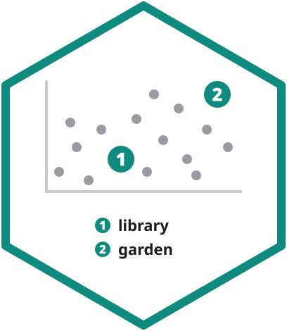

```{r}
#| label: setup
#| include: false
library(ggplot2)
library(ggindex)
theme_set(theme_minimal(base_size = 16))
```

## {data-autoslide="5000"}

{.title-logo}

<h1 style="font-size: 3em; margin-top: 1.2em;">ggindex</h1>

[Numbered markers on a plot, explained in a legend — like an annotated map.]{.lead}

::: {style="margin-top: 2em;"}
`install.packages("ggindex")`

[github.com/discindo/ggindex](https://github.com/discindo/ggindex)
:::

## The problem

Numbering a few points is easy with `geom_label()`.

Explaining the numbers is not: ggplot2 has no legend for them.

```{r}
#| label: problem
df <- data.frame(x = 6:10, y = 6:10, id = 1:5)
df$label <- paste0("Label", df$id)

ggplot(df, aes(x, y)) +
  geom_point() +
  geom_label(aes(label = id), nudge_x = 0.2)
```

## The usual workaround

Paste the number into the text, map it to an invisible layer, hide the keys.

Works, but the legend has no markers, `fill` is used up, and the numbers live in two places.

```{r}
#| label: workaround
df$legend <- paste0(df$id, ": ", df$label)

ggplot(df, aes(x, y)) +
  geom_point(aes(fill = legend), alpha = 0) +
  geom_point() +
  geom_label(aes(label = id), nudge_x = 0.2) +
  scale_fill_discrete(name = "Index") +
  theme(legend.key.width = unit(0, "cm"))
```

## With ggindex: `geom_focus()`

Same data. Map `label` and `info`: numbered markers on the plot and in the legend, from one mapping.

Without `label`, entries are numbered in data order.

```{r}
#| label: ggindex
ggplot(df, aes(x, y,
               label = id,
               info = label)) +
  geom_focus() +
  scale_info_discrete("Index")
```

## Choose your own numbers

Map `label`. The legend sorts by number; markers grow to fit.

```{r}
#| label: label
sites <- data.frame(
  x = c(6, 7, 8, 9, 10),
  y = c(6, 9, 7, 10, 8),
  code = c(12, 3, 104, 7, 45),
  name = c("Library", "Main hall",
           "Sports centre", "Cafeteria",
           "Car park")
)

ggplot(sites,
       aes(x, y, label = code, info = name)) +
  geom_focus()
```

## Focus on a subset

Map `focus` to number only some observations.

```{r}
#| label: focus
cars <- mtcars
cars$model <- rownames(cars)
cars$rank <- rank(-cars$mpg,
                  ties.method = "first")

ggplot(cars, aes(wt, mpg)) +
  geom_point(colour = "grey60") +
  geom_focus(aes(label = rank,
                 focus = rank <= 5,
                 info = model)) +
  scale_info_discrete("Most efficient")
```

## Maps with `geom_sf_focus()`

```{r}
#| label: map
nc <- sf::st_read(
  system.file("shape/nc.shp", package = "sf"),
  quiet = TRUE
)
nc <- sf::st_transform(nc, 32119)
nc_large <- nc[nc$AREA > 0.2, ]

ggplot(nc) +
  geom_sf(fill = "grey90", colour = "white") +
  geom_sf_focus(aes(info = NAME),
                data = nc_large) +
  scale_info_discrete("Largest counties") +
  theme_void(base_size = 16)
```

## Events on a line chart

```{r}
#| label: line
events <- data.frame(
  date = as.Date(c("2001-03-01", "2007-12-01",
                   "2008-09-15")),
  event = c("Dot-com recession begins",
            "Great Recession begins",
            "Lehman Brothers collapses")
)
events$unemploy <- approx(
  economics$date, economics$unemploy,
  events$date
)$y

ggplot(economics, aes(date, unemploy)) +
  geom_line() +
  geom_focus(aes(info = event), data = events) +
  scale_info_discrete("Events") +
  labs(x = NULL, y = "Unemployed (thousands)")
```

## Outliers in a distribution

Observations sharing an `info` value share a number.

```{r}
#| label: box
ggplot(mpg, aes(class, hwy)) +
  geom_boxplot(outliers = FALSE) +
  geom_focus(aes(info = model,
                 focus = hwy > 40)) +
  scale_info_discrete("Outliers") +
  labs(x = NULL,
       y = "Highway miles per gallon")
```

## The legend as a table

```{r}
#| label: density
w <- faithful$waiting
d <- density(w)
st <- data.frame(
  stat = c("Mean", "Median", "Mode"),
  x = c(mean(w), median(w),
        d$x[which.max(d$y)])
)
st$y <- approx(d$x, d$y, st$x)$y
st$info <- sprintf("%s: %.1f min",
                   st$stat, st$x)

ggplot(faithful, aes(waiting)) +
  geom_density(fill = "grey90") +
  geom_focus(aes(x, y, info = info),
             data = st) +
  scale_info_discrete(NULL)
```

## Regular ggplot2 scales

`colour`, `fill`, `shape`, `size` work as usual.

```{r}
#| label: scales
cars$best <- cars$mpg ==
  ave(cars$mpg, cars$cyl, FUN = max)

ggplot(cars, aes(wt, mpg)) +
  geom_point(colour = "grey60") +
  geom_focus(
    aes(label = rank, focus = best,
        info = model, fill = factor(cyl)),
    shape = 22, size = 7
  ) +
  scale_fill_brewer("Cylinders",
                    palette = "Set2") +
  scale_info_discrete("Best in class")
```

## Follows themes and coordinates

```{r}
#| label: radial
classes <- as.data.frame(
  table(class = mpg$class),
  responseName = "n"
)

ggplot(classes, aes(class, n)) +
  geom_col(fill = "grey40") +
  geom_focus(aes(info = class,
                 focus = n > 40)) +
  scale_info_discrete("Most common") +
  coord_radial() +
  labs(x = NULL, y = NULL) +
  theme_minimal(base_size = 16,
                ink = "white",
                paper = "grey15")
```

## {.center .nostretch data-autoslide="5000"}

{fig-align="center" width="440" fig-alt="Discindo Data Solutions"}
